# ShopKart

A full-stack e-commerce web app: browse products, keep a wishlist, manage a cart, pay with Razorpay (test mode) and track your orders.

**Live demo:** https://shop-kart-two-zeta.vercel.app &nbsp;·&nbsp; **API:** https://shopkart-1t5e.onrender.com

## Features

- **Authentication**
  - Register, log in and log out. Changing the password is also supported through the API.
  - The login token (JWT) is stored in an `httpOnly` cookie, and passwords are hashed with bcrypt.
  - Login and signup share one screen with sliding tabs, a short intro to the store and a step guide (create account → log in). After signing up, the login page confirms the new account and fills in the email.
- **Home page** – a welcome message, shortcuts to products, wishlist, cart and orders (with live cart totals), shop-by-category tiles, new arrivals and a "how ordering works" guide.
- **Products**
  - Listing with search, category filter and sorting (newest, price low→high, price high→low).
  - A product details page, with stock status shown on every product.
- **Wishlist**
  - Add, remove or toggle products with clear saving, saved and error states.
  - The wishlist is saved to your account.
- **Cart**
  - "Add to Cart" turns into a − / + quantity stepper on product cards and the product page. At quantity 1 the minus becomes a remove button.
  - Quantities are checked against live stock on the server.
  - The navbar, product cards and the cart page share one cart state, so they always agree.
- **Checkout & payments**
  - Shipping address validation and Razorpay Checkout (test mode).
  - The order total is always calculated on the server.
  - The payment signature is verified (HMAC-SHA256) before an order is marked paid. Stock is reduced and the cart cleared only after a verified payment.
- **Orders**
  - Order history, order details and an order-success page, each with a status tracker (Placed → Confirmed → Shipped → Delivered).
  - Prices are saved at purchase time.
- **Navigation & design**
  - A navbar that stays on screen with live wishlist and cart counts and a highlight that slides to the current page.
  - Pages fade in, and the browser tab shows the current page title.
  - A dark theme that works on phones as well as desktops.

## Screenshots

### Sign up and log in
Login and signup share one screen with a sliding tab. Signup shows a two-step guide (create account, then log in).

<table>
  <tr>
    <td>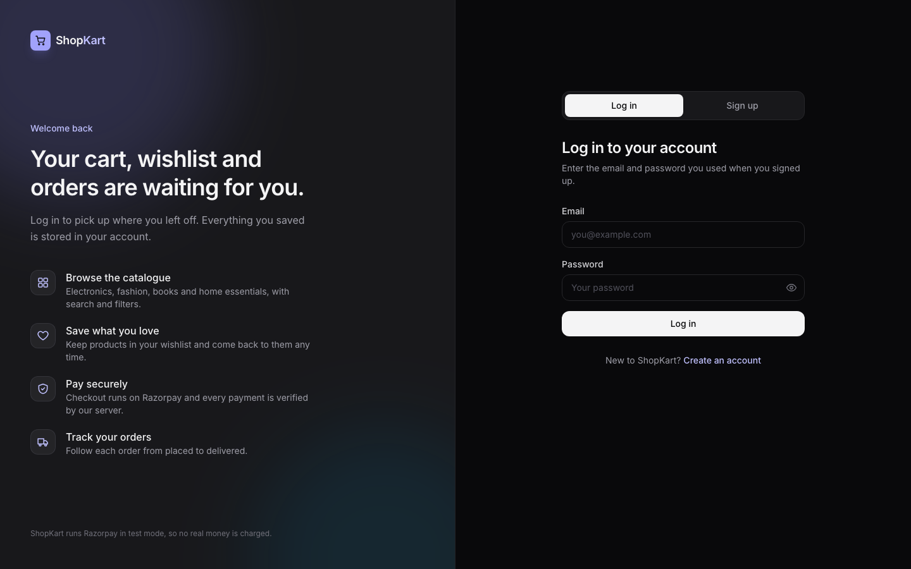</td>
    <td>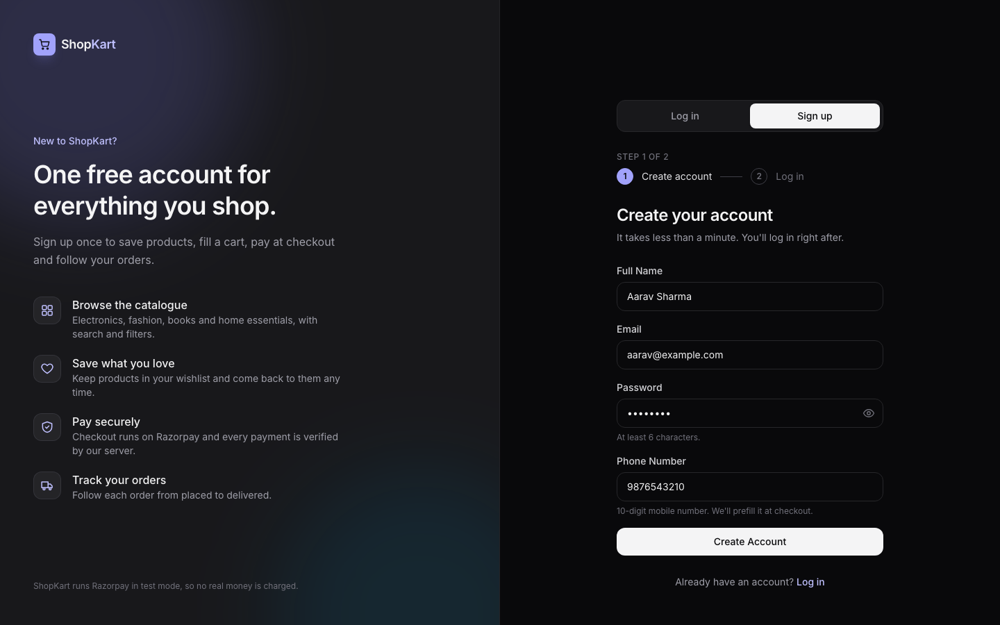</td>
  </tr>
</table>

### Home and products
The home page has quick links, categories and new arrivals. The product list supports search, category filter and price sorting. Once an item is in the cart, its button becomes a quantity stepper.

<table>
  <tr>
    <td>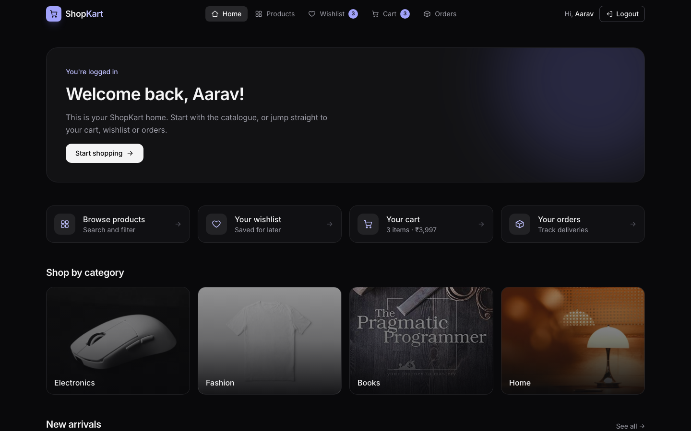</td>
    <td>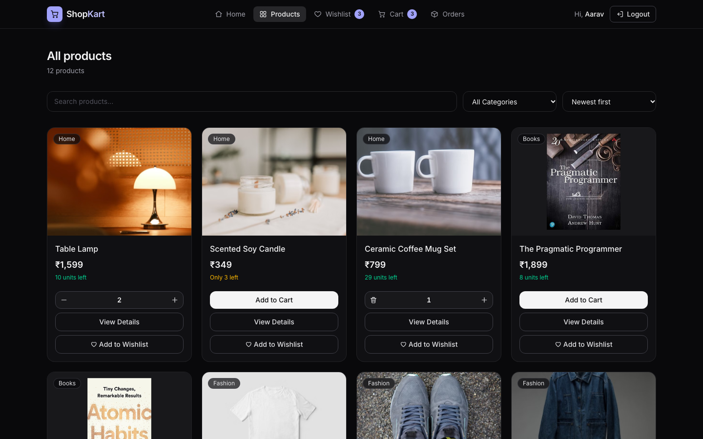</td>
  </tr>
  <tr>
    <td>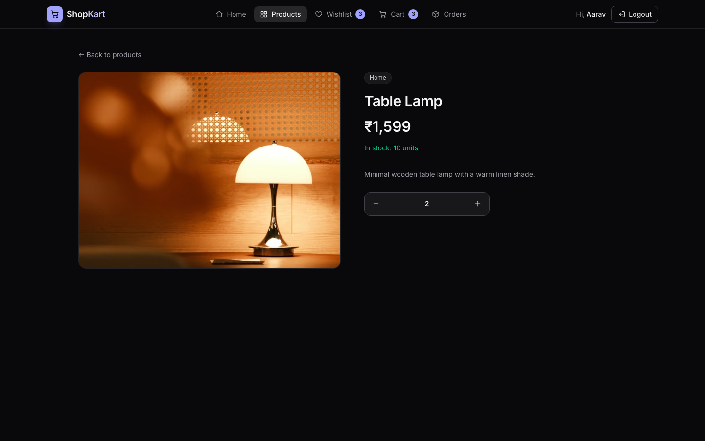</td>
    <td>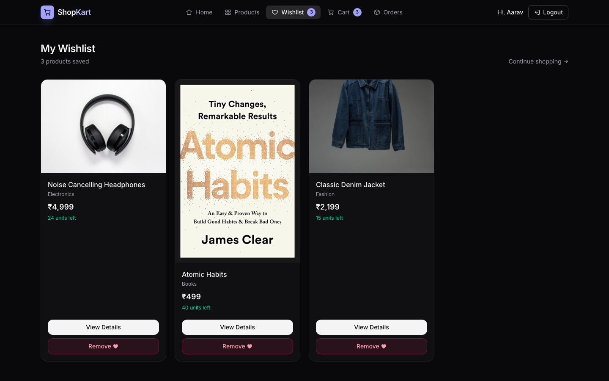</td>
  </tr>
</table>

### Cart, checkout and payment
Cart quantities are checked against live stock. Checkout validates the shipping address, and payment runs through Razorpay Checkout in test mode.

<table>
  <tr>
    <td>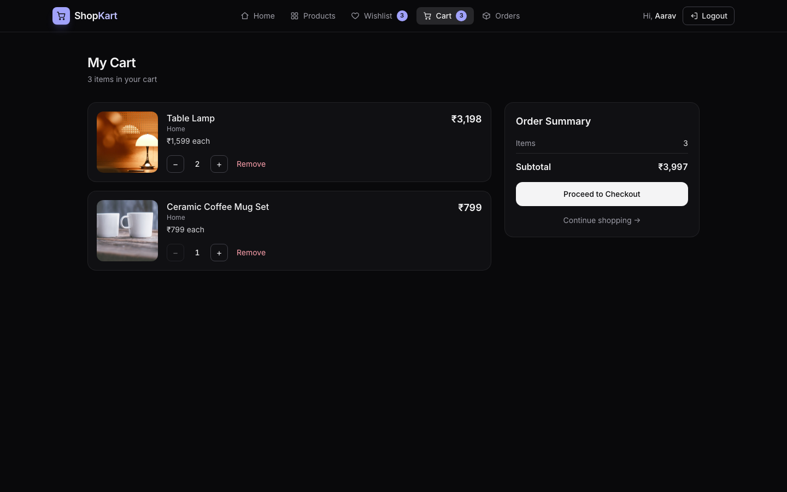</td>
    <td>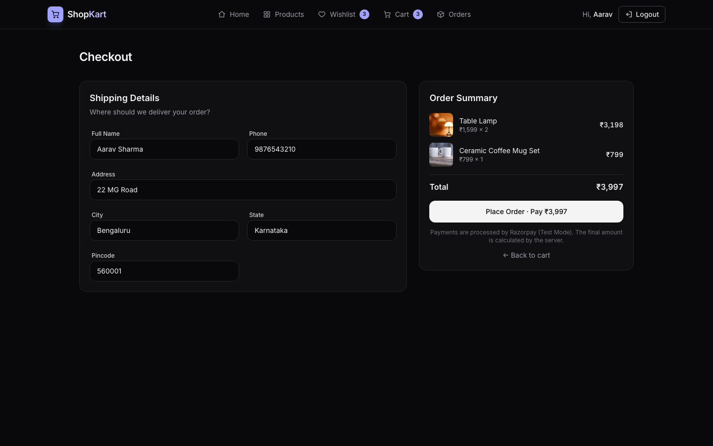</td>
  </tr>
  <tr>
    <td colspan="2" align="center">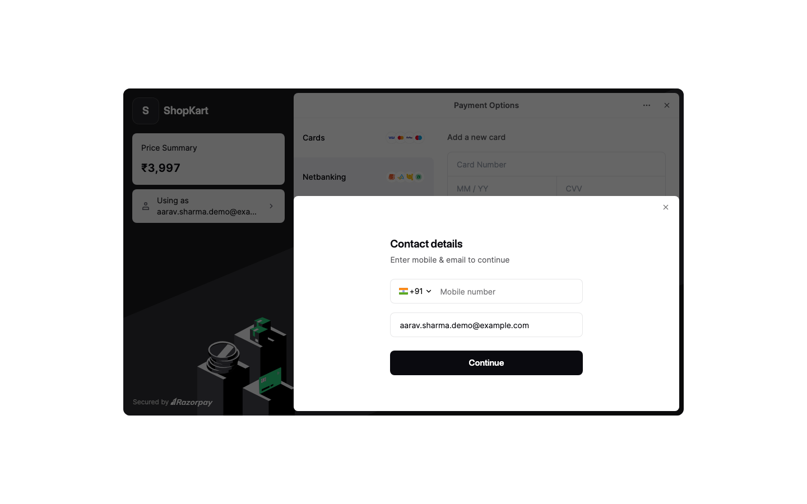</td>
  </tr>
</table>

### Orders
After the payment signature is verified, the order is confirmed, the cart is emptied, and the order shows up in My Orders with a status tracker.

<table>
  <tr>
    <td>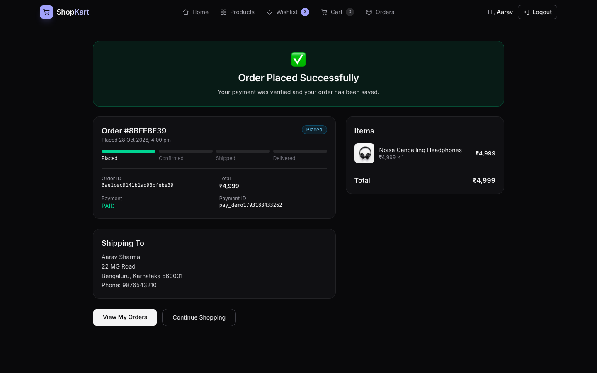</td>
    <td>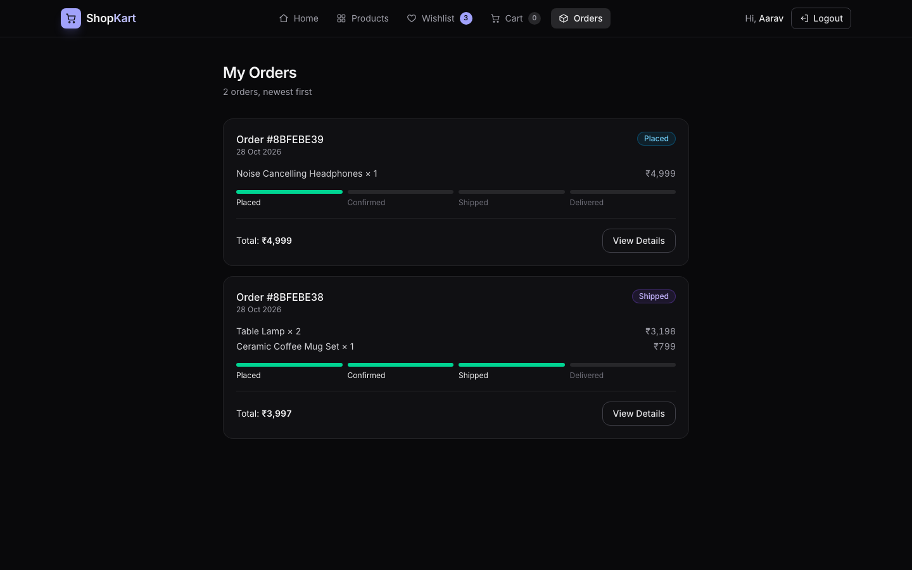</td>
  </tr>
</table>

### On a phone

<p align="center">
  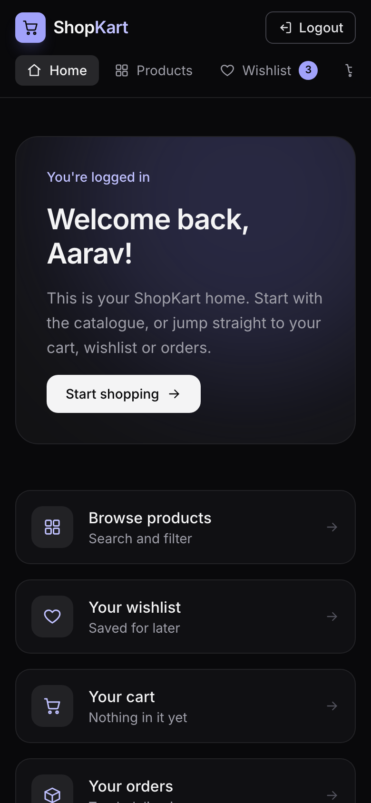
  &nbsp;&nbsp;
  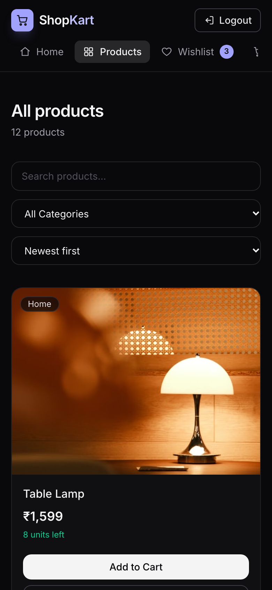
</p>

## Tech Stack

| Layer    | Technology |
| -------- | ---------- |
| Frontend | React 19, React Router 7, Vite, Tailwind CSS 4, Axios |
| Backend  | Node.js, Express 5, Mongoose, JWT, bcrypt, cookie-parser |
| Database | MongoDB (Atlas) |
| Payments | Razorpay (test mode) |

## Project Structure

```
SHOPKART/
├── backend/
│   ├── config/         # Razorpay client
│   ├── controllers/    # Route handlers (customer, product, wishlist, cart, order)
│   ├── middlewares/    # JWT auth middleware
│   ├── models/         # Mongoose models (Customer, Product, Order)
│   ├── routes/         # Express routers
│   ├── utils/          # Token generation, address validation, product seeder
│   └── index.js        # App entry point
├── docs/
│   └── screenshots/    # Images used in this README
└── frontend/
    └── src/
        ├── components/ # Reusable UI components
        ├── context/    # Cart context (global cart state)
        ├── pages/      # Route pages
        ├── services/   # API calls (Axios)
        └── utils/      # Formatting, validation, Razorpay script loader
```

## Getting Started

### Prerequisites

- [Node.js](https://nodejs.org/) 20 or later
- A MongoDB database (a free [MongoDB Atlas](https://www.mongodb.com/atlas) cluster works)
- A [Razorpay](https://razorpay.com/) account with **Test Mode** API keys

### 1. Clone the repository

```bash
git clone https://github.com/Kush-8912/ShopKart.git
cd ShopKart
```

### 2. Set up the backend

```bash
cd backend
npm install
cp .env.example .env
```

Fill in `backend/.env`:

| Variable              | Description |
| --------------------- | ----------- |
| `dbUrl`               | MongoDB connection string |
| `jwt_secret`          | Any long random string, used to sign login tokens |
| `RAZORPAY_KEY_ID`     | Razorpay test Key ID (`rzp_test_...`) |
| `RAZORPAY_KEY_SECRET` | Razorpay test Key Secret |
| `PORT`                | Optional, defaults to `8085` |
| `CLIENT_URL`          | Optional, extra allowed CORS origin(s), comma-separated |
| `NODE_ENV`            | Optional, set to `production` when deployed |

Load the sample products, then start the server:

```bash
npm run seed   # inserts 12 sample products (replaces existing products)
npm run dev    # http://localhost:8085
```

### 3. Set up the frontend

In a second terminal:

```bash
cd frontend
npm install
npm run dev    # http://localhost:5173
```

The frontend sends API requests to `/api`, which the Vite dev server forwards to `http://localhost:8085`, so no frontend `.env` is needed.

### 4. Try a payment

Register an account, add products to your cart and check out. In the Razorpay test popup, use the UPI ID `success@razorpay` or any card from Razorpay's [test card list](https://razorpay.com/docs/payments/payments/test-card-details/). No real money is charged.

## API Reference

Base URL: `http://localhost:8085`. 🔒 = requires login (cookie).

**Customers**

| Method | Endpoint | Description |
| ------ | -------- | ----------- |
| POST  | `/customers/register` | Register (`fullName`, `email`, `password`, `phone`) |
| POST  | `/customers/login` | Log in, sets the `token` cookie |
| GET   | `/customers/me` 🔒 | Current user's profile |
| POST  | `/customers/logout` 🔒 | Log out, clears the cookie |
| PATCH | `/customers/change-password` 🔒 | Change password (`oldPassword`, `newPassword`) |

**Products**

| Method | Endpoint | Description |
| ------ | -------- | ----------- |
| GET  | `/products` | List products. Query: `search`, `category`, `sort` (`newest`, `price_asc`, `price_desc`) |
| GET  | `/products/:id` | Product details |
| POST | `/products` 🔒 | Create a product |

**Wishlist** 🔒

| Method | Endpoint | Description |
| ------ | -------- | ----------- |
| GET    | `/wishlist` | Get wishlist |
| POST   | `/wishlist/:productId` | Add product |
| DELETE | `/wishlist/:productId` | Remove product |
| PATCH  | `/wishlist/:productId/toggle` | Add if missing, remove if present |

**Cart** 🔒

| Method | Endpoint | Description |
| ------ | -------- | ----------- |
| GET    | `/cart` | Get cart |
| POST   | `/cart/:productId` | Add one unit |
| PATCH  | `/cart/:productId` | Set quantity (`{ "quantity": 2 }`) |
| DELETE | `/cart/:productId` | Remove product |

**Orders** 🔒

| Method | Endpoint | Description |
| ------ | -------- | ----------- |
| POST  | `/orders/create-payment-order` | Create an order from the cart and a Razorpay order (`shippingAddress`) |
| POST  | `/orders/verify-payment` | Verify the Razorpay signature and place the order |
| GET   | `/orders` | Order history |
| GET   | `/orders/:id` | Order details |
| PATCH | `/orders/:id/advance-status` | Move an order to its next status (development only) |

## Deployment

The app is set up to run with the backend on [Render](https://render.com) and the frontend on [Vercel](https://vercel.com).

**Backend (Render → New → Web Service)**

- Root directory: `backend`
- Build command: `npm install`
- Start command: `npm start`
- Environment variables: `dbUrl`, `jwt_secret`, `RAZORPAY_KEY_ID`, `RAZORPAY_KEY_SECRET`, `NODE_ENV=production`
- In MongoDB Atlas → Network Access, allow `0.0.0.0/0` so Render can connect.

**Frontend (Vercel → Add New → Project)**

- Root directory: `frontend` (framework preset: Vite)
- In `frontend/vercel.json`, set the `/api` rewrite destination to your Render URL.

Vercel forwards `/api/*` requests to the backend, so the login cookie stays on the frontend's domain and works in browsers that block third-party cookies.

## Author

Kushagra Aggarwal
